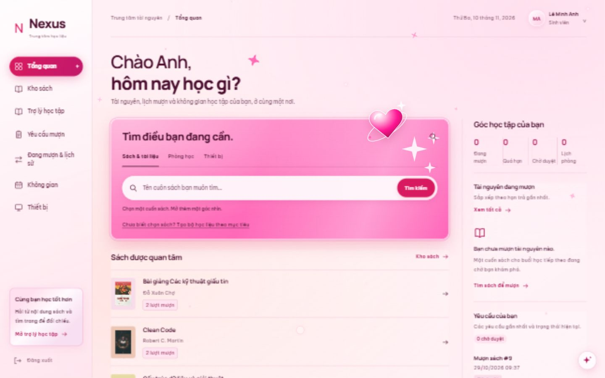
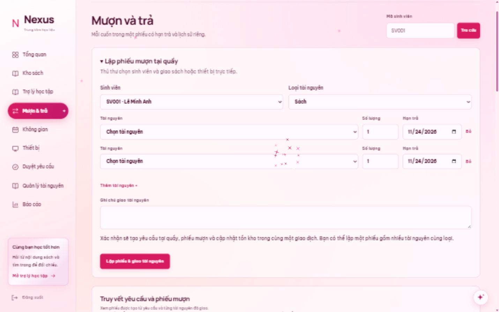
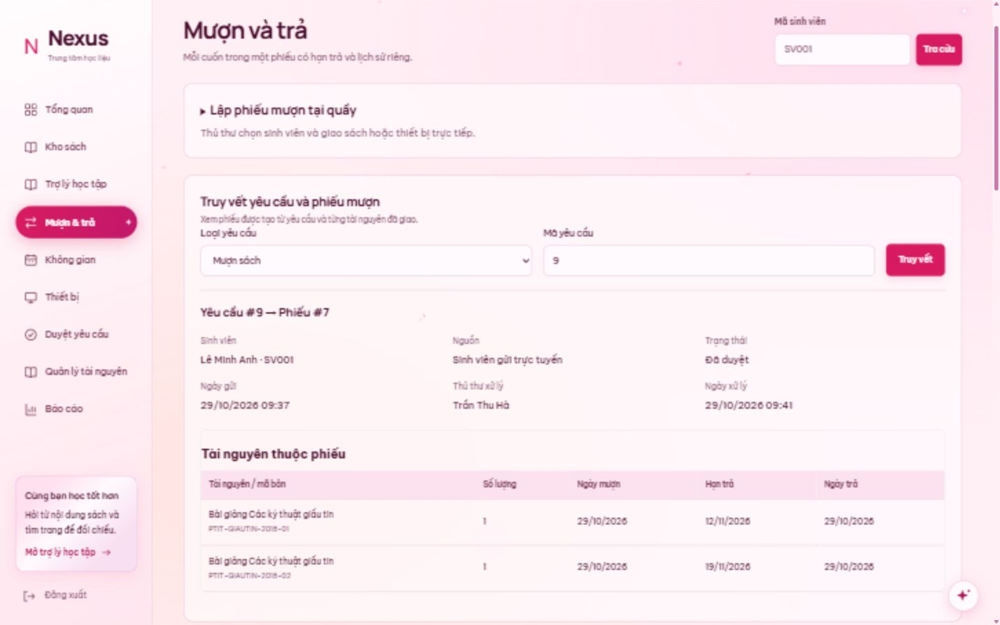

# Nexus Learning Resource Center

**Một nơi cho mọi điều bạn muốn học.** Tra cứu sách, mượn thiết bị, đặt không gian học tập và học cùng trợ lý Nexus.

[](https://btl-csdl-onqi.onrender.com/)
[](Dockerfile)
[](docs/database-schema.md)



## Khám phá Nexus

Gia hạn sách: sinh viên gửi yêu cầu từ **Đang mượn & lịch sử**, thủ thư duyệt hoặc từ chối trong **Mượn & trả**. [Luồng nghiệp vụ, API và migration](docs/extension-requests.md).

| Dành cho sinh viên | Dành cho thủ thư và quản trị |
|---|---|
| Tìm sách, xem bìa và đọc PDF | Duyệt yêu cầu, cấp phát bản sách, nhận trả và gia hạn |
| Gửi yêu cầu mượn, đặt phòng, theo dõi lịch sử | Lập phiếu trực tiếp tại quầy cho sinh viên |
| Trợ lý học tập và bộ học liệu theo mục tiêu | Quản lý thông tin, hình ảnh và ẩn/hiện tài nguyên |
| Xem tài nguyên và trạng thái thực tế | Xem hồ sơ tài khoản, báo cáo và truy vết yêu cầu–phiếu |

<table>
  <tr>
    <td width="50%"><strong>Lập phiếu tại quầy</strong><br><br><a href="docs/images/counter-lending.png"></a></td>
    <td width="50%"><strong>Truy vết rõ ràng</strong><br><br><a href="docs/images/request-trace.png"></a></td>
  </tr>
</table>

Giao diện **Pink Glam / Y2K Sparkle** có nền hồng kem, kính mờ, trái tim bóng, bụi sao và hiệu ứng tương tác. Nút ngôi sao cho phép tắt chuyển động; hệ thống hỗ trợ tùy chọn giảm chuyển động của thiết bị. Ảnh trên chụp từ bản desktop với dữ liệu demo.

**Tài liệu để tìm hiểu và bảo vệ đồ án:** [Nghiệp vụ & chuẩn hóa](docs/normalization.md) · [Từ điển CSDL](docs/database-schema.md) · [ERD](docs/database-erd.mmd) · [SQL demo](docs/teacher-demo.sql) · [Triển khai](docs/hosting.md)

## Bổ sung nghiệp vụ và mô hình CSDL — 10/11/2026

- Admin: Quản trị → Xem chi tiết tài khoản để xem liên hệ, hồ sơ sinh viên/thủ thư và lịch sử liên quan.
- Thủ thư: Mượn & trả → Lập phiếu mượn tại quầy (nhiều sách hoặc nhiều thiết bị trong một phiếu, chọn sinh viên và hạn trả từng dòng).
- Mượn & trả → Truy vết yêu cầu và phiếu mượn. Phiếu mới lưu `request_id` với FK/UNIQUE; nguồn yêu cầu phân biệt `online`/`counter`.
- CSDL cũ: cấu hình `NEXUS_DB_*`, chạy `php scripts/migrate-circulation.php --check`, rồi `--apply` để nâng cấp. Runner tự tạo backup trước DDL và có thể chạy lại. Sau khi khởi tạo mới bằng schema/seed cũng chạy migration để khởi tạo số lượng không khả dụng và khôi phục liên kết có đủ bằng chứng.
- Tài liệu thống nhất: [nghiệp vụ và chuẩn hóa](docs/normalization.md), [từ điển CSDL](docs/database-schema.md), [ERD Mermaid](docs/database-erd.mmd). Sinh lại hai tài liệu metadata bằng `php scripts/document-schema.php` sau migration. Không dùng bản xuất cũ `cautruc.sql` thay mô hình hiện hành.

Web chính: **https://btl-csdl-onqi.onrender.com/** — [cấu hình hosting](docs/hosting.md).

Ban demo full-stack cho he thong quan ly trung tam tai nguyen hoc tap.

## Cong nghe

- PHP 8+ voi PDO
- MySQL 8+
- HTML, CSS, JavaScript thuan
- MySQL schema va seed data nam trong `database/`

## Chay local

1. Tao database bang `database/schema.sql`.
2. Nap du lieu mau bang `database/seed.sql`.
3. Sao chép cấu hình mẫu rồi điền thông tin MySQL của bạn:

```powershell
Copy-Item app/config.example.php app/config.php
```

`app/config.php` trên GitHub chỉ đọc cấu hình từ biến môi trường, không chứa thông tin đăng nhập.
Đặt `NEXUS_DB_HOST`, `NEXUS_DB_PORT`, `NEXUS_DB_NAME`, `NEXUS_DB_USER`, `NEXUS_DB_PASS`
trong môi trường chạy. Sau schema/seed, chạy `php scripts/migrate-circulation.php --apply` để ghi số dư đầu kỳ và nâng cấp liên kết.

4. Chay PHP built-in server:

```powershell
cd resource-center-demo
php -S 127.0.0.1:8000 -t public
```

5. Mo `http://127.0.0.1:8000`.

Hoac chay nhanh bang PowerShell:

```powershell
.\start.ps1
```

File PDF sach dien tu duoc luu trong `storage/ebooks`, khong dat trong thu muc web cong khai. Trang doc chi phuc vu file qua `public/ebook.php` sau khi tai khoan dang nhap.

Bản GitHub chứa mã nguồn và dữ liệu demo trong các file SQL; không chứa database
đang dùng, mật khẩu MySQL, khóa AI, cookie, lịch sử trò chuyện hoặc toàn văn PDF.
Bạn tự thêm PDF để sử dụng đọc sách và tra cứu toàn văn. Hình ảnh đã chọn có nguồn
tại `docs/resource-image-import.json`.

Neu da tao CSDL truoc phien ban nay, chay them `database/migrate_borrow_requests.sql` trong MySQL Workbench. File migration bo cot trang thai tai khoan va them cac bang yeu cau muon sach/thiet bi.

Neu MySQL cua ban co mat khau root, cap nhat `DB_PASS` trong `app/config.php` truoc khi dang nhap.

Tai khoan demo:

| Vai tro | Ten dang nhap | Mat khau |
| --- | --- | --- |
| Quan tri vien | `user1` | `12345` |
| Thu thu | `user2` | `12345` |
| Sinh vien | `user3` | `12345` |

Mật khẩu được lưu bằng bcrypt; tài khoản demo vẫn dùng mật khẩu 12345. Với dữ liệu cũ, chạy `php scripts/hash-passwords.php --apply` một lần sau khi backup. Không dùng mật khẩu demo cho production.

## Luong muon tai nguyen

- Sinh vien them sach trong **Kho sach** hoac thiet bi trong **Thiet bi**, chon han tra rieng cho tung muc, sau do gui yeu cau.
- Sinh vien chon khung gio, nhap muc dich va bam **Dat phong +** trong **Khong gian** de gui yeu cau dat phong.
- Thu thu mo **Duyet yeu cau** de duyet hoac tu choi. Khi duyet, he thong tao phieu muon va cap nhat ban sao sach/so luong thiet bi con san.
- Trang thai chi ap dung cho yeu cau va tai nguyen; tai khoan khong con cot "trang thai hoat dong".


## Giao diện Open Campus — 04/11/2026

Lượt tối ưu tiếp theo tập trung desktop từ 1000px: tăng độ dễ đọc, giỏ mượn trống có nút chọn tài nguyên, nhãn ngày/giờ đặt phòng và dòng tóm tắt kết quả, thống nhất màu trạng thái yêu cầu. Style nằm trong `public/assets/campus-desktop.css`. Kiểm tra bằng `node scripts/desktop-polish-check.cjs` trên 1024/1280/1440/1920px; ảnh và kết quả nằm tại `.impeccable/review/desktop-polish/`. Không tối ưu lại bố cục điện thoại trong lượt này.

- Ưu tiên sinh viên: vùng tìm sách và điều hướng phòng/thiết bị, danh sách sách được quan tâm, cột hoạt động cá nhân với dữ liệu thực tế.
- Nền kem, xanh lá táo, chữ Manrope và Be Vietnam Pro; font WOFF2 và giấy phép nằm tại `public/assets/fonts/`, không gọi Google Fonts khi mở ứng dụng.
- Menu có nhãn trên desktop; trên điện thoại có nút mở/đóng, focus vào mục điều hướng và đóng bằng Escape.
- Quy tắc thiết kế được ghi trong `DESIGN.md`; style mới tại `public/assets/campus.css`.
- Kiểm tra giao diện và tương tác: `node scripts/redesign-tools.cjs verify`. Lệnh dùng Chrome, Playwright và server local tại cổng 8000; đăng nhập tài khoản demo, mở biểu mẫu nhưng không gửi yêu cầu mượn/đặt phòng hay gọi AI.
- Chụp bảy màn sinh viên tại 1440px, 1024px và 390px: `node scripts/redesign-tools.cjs`. Ảnh lưu trong `.impeccable/review/`.
- Bản sao frontend trước thay đổi: `E:/Dell Gaming/resource-center-backups/open-campus-20261104/`.

## Cập nhật web desktop — 03/11/2026

- Bố cục workspace với sidebar có nhãn, breadcrumb, ngày thực tế và tài khoản.
- Tổng quan theo vai trò: dữ liệu cá nhân cho sinh viên; hàng chờ và công việc cho thủ thư; báo cáo/tài khoản cho quản trị.
- Kho sách phân trang 12 mục, tìm kiếm nhanh từ tổng quan, bìa thiếu ảnh hiển thị gọn.
- URL theo màn hình (`#catalog`, `#spaces`, ...), giữ màn hình khi tải lại, hỗ trợ Back/Forward.
- Lịch tuần cuộn trong panel; cải thiện focus và thao tác bàn phím trong hộp thoại.
- Phạm vi kiểm tra: web desktop 1024–1920px, ba tài khoản demo. Không thay đổi schema hay dữ liệu MySQL.

Backup toàn bộ file trước khi sửa: `E:\Dell Gaming\resource-center-demo-backup-20261103-151202.zip`.
Backup này là bản sao source và các file trong dự án, không phải bản dump database.

Khôi phục: dừng server, giải nén backup vào thư mục riêng, rồi dùng bản dự án trong đó.
Không ghi đè thư mục đang làm việc khi chưa giữ lại các thay đổi mới hơn.


## Quản lý tài nguyên và quyền truy cập

- Thủ thư (`user2`) và quản trị (`user1`) mở **Quản lý tài nguyên** để thêm/sửa đầu sách, bản sách, phòng và thiết bị.
- Sách: metadata, tác giả, thể loại, từ khóa; tải bìa JPG/PNG/WebP tối đa 2 MB. Các tên trong danh sách ngăn cách bằng dấu `;`.
- Bản sách: mã vạch duy nhất, vị trí, tình trạng và trạng thái. Bản đang mượn phải được nhận trả trước khi chỉnh sửa.
- Thiết bị: sửa tổng số lượng không được làm mất số đang mượn/không khả dụng; số còn sẵn tự tính. Nhận trả không tự bỏ trạng thái bảo trì/hư hỏng.
- Không xóa cứng lịch sử giao dịch. Phòng có thể chuyển bảo trì/tạm ngừng; bản sách và thiết bị có trạng thái hư hỏng tương ứng.
- Biểu mẫu kiểm tra phiên bản: nếu người khác sửa trước, API trả 409 và giữ nội dung biểu mẫu để người dùng xem lại.
- API yêu cầu đăng nhập, kiểm tra vai trò và quyền sở hữu dữ liệu. Lịch phòng chung vẫn hiển thị chỗ đã đặt, nhưng che tên/mã sinh viên và mục đích của người khác.
- Các yêu cầu ghi sử dụng token CSRF. Tải lại trang sau khi cập nhật phiên bản ứng dụng.

Mật khẩu cũ được nâng cấp khi đăng nhập. Lệnh `php scripts/hash-passwords.php` chỉ xem số tài khoản cần nâng cấp; thêm `--apply` mới thực hiện thay đổi.
Giữ nguyên tên đăng nhập và mật khẩu hiện tại khi chuyển sang bcrypt.

Kiểm thử tích hợp và đồng thời: xem `tests/README.md`.


## Trợ lý học tập Gemini

### Bộ học liệu theo mục tiêu

Trong **Trợ lý học tập**, mở **Bộ học liệu theo mục tiêu**, hoặc dùng lối tắt ở vùng tìm sách trên Tổng quan. Nhập mục tiêu 10–600 ký tự, thời gian 1–12 tuần, 15–180 phút/ngày và trình độ hiện tại. Nexus chọn tối đa 3 sách trong danh mục, nêu lý do/chủ đề nên tập trung và lập kế hoạch theo tuần. Phần có bằng chứng dẫn đến trang PDF; metadata được phân biệt với nội dung toàn văn. Bài thực hành và kế hoạch được ghi là gợi ý học tập.

Bộ gần nhất lưu riêng mỗi tài khoản tại `storage/assistant/learning-kit-user-<id>.json`, ngoài public. GET/POST `/api/assistant/learning-kit` yêu cầu đăng nhập; POST kiểm tra CSRF, giới hạn đầu vào, khóa theo tài khoản và dùng chung quota AI. Request ID cho phép nhận lại cùng kết quả khi thử lại yêu cầu đã thành công. Không gửi hồ sơ, tài khoản hoặc mật khẩu tới nhà cung cấp AI.

Tồn kho được cập nhật khi mở lại bộ học liệu và kiểm tra lần nữa trước khi thêm sách. Chọn hạn trả dự kiến rồi thêm sách vào giỏ; thao tác này chưa gửi phiếu mượn. Sách hết bản vẫn có thể mở PDF nếu có. Khi AI lỗi, giữ mục tiêu và bộ trước đó; mục tiêu không phù hợp kho trả trạng thái không tìm thấy.

Kiểm tra offline: `python tests/test_learning_kit.py` và `node tests/learning-kit-ui.cjs` (UI giả lập AI, không phát sinh inference). Lệnh `node scripts/learning-kit-live-check.cjs` **gọi AI thật**, lưu bộ cho tài khoản demo user3, kiểm tra lưu/mở lại, replay và phân tách tài khoản; không gửi yêu cầu mượn.

Mở **Trợ lý học tập** trong menu hoặc **Hỏi Nexus về cuốn sách này** ở chi tiết sách.
Có bốn mục tiêu: hỏi kiến thức, tóm tắt sách, lộ trình học và học được gì.
Chọn tối đa 3 sách hoặc bỏ chọn để tìm trong toàn kho. Trích dẫn mở đúng trang PDF.

Đây là tra cứu nội dung sách bằng RAG, không phải fine-tune model AI.
PDF được trích văn bản và lập chỉ mục SQLite FTS5 tại máy chủ. Chỉ câu hỏi,
lịch sử hội thoại cần thiết, thông tin danh mục và các đoạn liên quan được gửi
đến nhà cung cấp AI đang cấu hình. Không gửi mật khẩu, hồ sơ sinh viên hoặc toàn bộ database.
Tóm tắt sử dụng các trang mẫu trải đều và đoạn tìm được; không bảo đảm bao quát
mọi chi tiết. Sách chưa có PDF hoặc cần OCR được ghi rõ trong danh sách nguồn.

### Cấu hình phía server

- Sao chép `storage/ai-config.example.json` thành `storage/ai-config.json` và điền key.
- File này nằm ngoài `public`, bị git bỏ qua; không đưa vào tài liệu, log hay JavaScript.
- Có thể dùng biến môi trường `NEXUS_AI_PROVIDER`, `GROQ_API_KEY`, `GROQ_MODEL`, `NEXUS_PYTHON` (hoặc `GEMINI_API_KEY`, `GEMINI_MODEL` khi chọn Gemini) để ghi đè.
- Cần Python 3 với `pypdf` khi cập nhật chỉ mục; tìm kiếm và HTTP dùng thư viện chuẩn.
- Cấu hình `python` phải trỏ tới Python có pypdf. Bản local đã dùng runtime có sẵn.
- Bản local dùng `provider: "groq"`, model `openai/gpt-oss-120b`. Cấu hình không có `provider` vẫn được hiểu là Gemini để tương thích bản cũ.

### Cập nhật học liệu

Thủ thư/quản trị có nút **Cập nhật nguồn sách** trong màn trợ lý, hoặc chạy:

```powershell
php scripts/index-assistant.php
```

Script đọc đường dẫn PDF từ database, giữ số trang, tái sử dụng file chưa đổi và
thay chỉ mục bằng thao tác atomic sau khi hoàn tất. PDF scan cần OCR trước.
Thêm đầu sách chỉ có metadata không tự tạo ra nội dung toàn văn.

### Lưu trữ và giới hạn

Lịch sử lưu riêng theo ID tài khoản trong `storage/assistant`, ngoài thư mục web;
20 hội thoại gần nhất, tối đa 20 lượt hỏi mỗi hội thoại. API kiểm tra đăng nhập,
CSRF và khóa chống gửi đồng thời. Mỗi tài khoản tối đa 20 yêu cầu AI/giờ, toàn
hệ thống 100 yêu cầu/ngày. Khi dịch vụ AI lỗi, câu hỏi ở trình duyệt được giữ lại.
Đây là giới hạn local demo, không phải giới hạn chính thức của Google.
Nhà cung cấp có thể tính phí theo model và gói tài khoản; kiểm tra quota/billing khi vận hành thật.

Kiểm thử tra cứu offline (không gọi Gemini):

```powershell
python tests/test_assistant.py
```

Dùng cùng Python đã cấu hình nếu Python mặc định thiếu thư viện.

### Chẩn đoán lỗi AI

Khi chọn `gemini-3.6-flash`, worker dùng mức suy luận `minimal` cho hội thoại tương tác.
Worker thử lại lỗi mạng và HTTP 500/502/503/504 tối đa 3 lần, trong tổng ngân sách
55 giây. Không tự thử lại lỗi key, quyền truy cập hoặc hết quota.
Log PHP ghi `assistant_failure` với mã lỗi, HTTP status, provider status và loại
exception; không ghi key, câu hỏi hoặc nội dung sách.

Kiểm tra trực tiếp ngày 04/11/2026: API chấp nhận key; một câu tóm tắt trả HTTP 200,
nhưng các lần tiếp theo trả `503 UNAVAILABLE`. Google xác nhận model đang có nhu cầu
sử dụng cao. Đã đối chiếu nhiều model và cả API Interactions, cùng gặp lỗi quá tải.
Kiểm thử offline và giao diện thành công không chứng minh dịch vụ Google đã phục hồi.
Nếu lỗi 503 còn tiếp diễn cần chờ nhà cung cấp phục hồi hoặc cấu hình nhà cung cấp
khác; đổi thông báo lỗi hoặc tăng timeout không giải quyết được quá tải phía Google.

### Groq

Groq dùng endpoint cố định `https://api.groq.com/openai/v1/chat/completions`, xác thực
bằng header Authorization; key không xuất hiện trong URL, JavaScript hoặc API trả về
trình duyệt. Model mặc định `openai/gpt-oss-120b` dùng structured JSON strict và
reasoning effort low. Đọc `message.content`, không hiển thị reasoning.

Prompt Groq giữ câu hỏi hiện tại, ưu tiên metadata sách liên quan, lịch sử gần nhất
và tối đa 12 đoạn trích; tổng system + context không quá 12.000 byte UTF-8. Nguồn
được chọn luân phiên giữa các sách để giữ độ phủ khi chọn tối đa 3 sách. Chỉ những
mã nguồn đã gửi tới model mới được phép xuất hiện trong trích dẫn trả về.
Ngân sách byte giúp giảm kích thước prompt, không phải phép đếm token chính xác.
Gói free vẫn có thể báo 429 do token/phút hoặc token/ngày, kể cả chưa hết lượt hỏi.
Không tự chuyển sang dịch vụ hoặc model trả phí khi hết hạn mức.

Bản sao trước tích hợp: `E:/Dell Gaming/resource-center-backups/groq-20261104`.

## Ràng buộc dữ liệu MySQL — 04/11/2026

Đã áp dụng 16 CHECK và 1 UNIQUE trên database đang dùng:

- Số lượng yêu cầu mượn và chi tiết mượn thiết bị phải lớn hơn 0; tổng thiết bị > 0,
  số còn sẵn nằm trong khoảng 0 đến tổng số. Sức chứa phòng > 0.
- Số trang sách và dung lượng ebook nếu đã khai báo phải > 0; vẫn được để NULL.
- Hạn trả không trước ngày mượn; ngày nhận trả không trước ngày mượn.
- Khung đặt phòng trong 00:00–24:00, giờ kết thúc sau giờ bắt đầu.
- Hạn gia hạn mới sau hạn cũ; mỗi lượt mượn sách tối đa 3 lần gia hạn.
- Phiếu chưa trả không có kết quả/tình trạng nhận trả; phiếu đã trả phải có đủ
  thông tin. Đúng hạn/trễ hạn và số ngày trễ phải khớp ngày nhận trả và hạn trả.
- Cột VIRTUAL `loan_details.active_copy_id` và UNIQUE
  `uq_loan_details_active_copy` bảo đảm mỗi bản sách chỉ có một lượt mượn chưa trả.
  Nhiều lượt mượn đã trả của cùng bản sách vẫn được lưu bình thường.

Web tự tính kết quả trả và số ngày trễ từ ngày đã lưu; không nhận kết quả khai báo
thủ công từ trình duyệt. Ngày nhận trả là ngày hiện tại phía server. Lịch SQL dùng
session timezone +07:00, cùng lịch Asia/Bangkok của web. Lỗi CHECK trả HTTP 422;
tranh chấp bản sách đang mượn trả HTTP 409.

CHECK bảo vệ từng hàng; các nghiệp vụ liên bảng như cấp tồn kho và chống đặt phòng
trùng tiếp tục dùng transaction và khóa dòng trong ứng dụng.

Với database đang dùng:

```powershell
php scripts/migrate-integrity.php --check
php scripts/migrate-integrity.php --apply
```

`--check` chỉ đọc, trả exit code 2 nếu có vi phạm hoặc thiếu ràng buộc. `--apply`
tự sao lưu trước khi sửa và chạy lại an toàn nếu đã áp dụng. Migration dừng khi có
ngày/số lượng sai, thiếu tình trạng nhận trả hoặc bản sách bị mượn trùng. Migration
chỉ chuẩn hóa các trường kết quả/trạng thái có thể tính từ ngày đã lưu; không đổi
ngày mượn, hạn trả hay ngày nhận trả. Khi áp dụng trên hệ thống đang dùng, tạm dừng
web để tránh phát sinh giao dịch giữa các bước DDL. DDL MySQL tự commit từng bảng;
nếu bị ngắt, chạy lại runner để hoàn tất các phần còn thiếu.

`database/schema.sql` và `database/seed.sql` đã cập nhật cho cài mới.
`database/migrate_integrity.sql` là bản SQL tương đương để xem xét; dùng runner PHP
để có kiểm tra dữ liệu, backup và khả năng chạy lại.

Backup trước thay đổi:
`E:/Dell Gaming/resource-center-backups/20261103-180224/database.sql` và
`source-and-data.zip` trong cùng thư mục (không đóng gói file log đang mở).
Backup ngay trước migration chính:
`E:/Dell Gaming/resource-center-backups/integrity-20261103-180958-9066af/database.sql`.
Migration đã chuẩn hóa 6 phiếu sách và 2 phiếu thiết bị, giữ nguyên các ngày gốc.

Hàm snapshot trong `scripts/lib/database-snapshot.php` loại cột GENERATED khỏi
INSERT khi xuất dump; các cột thời gian DEFAULT_GENERATED vẫn được giữ nguyên.
Đã kiểm tra khôi phục và đối chiếu dữ liệu đầy đủ của 25 bảng.

## Hiển thị và hình ảnh tài nguyên

Xem hướng dẫn [quản lý hiển thị, xóa và hình ảnh](docs/resource-management.md), bao gồm migration, nguồn ảnh, sao lưu và kiểm tra.
